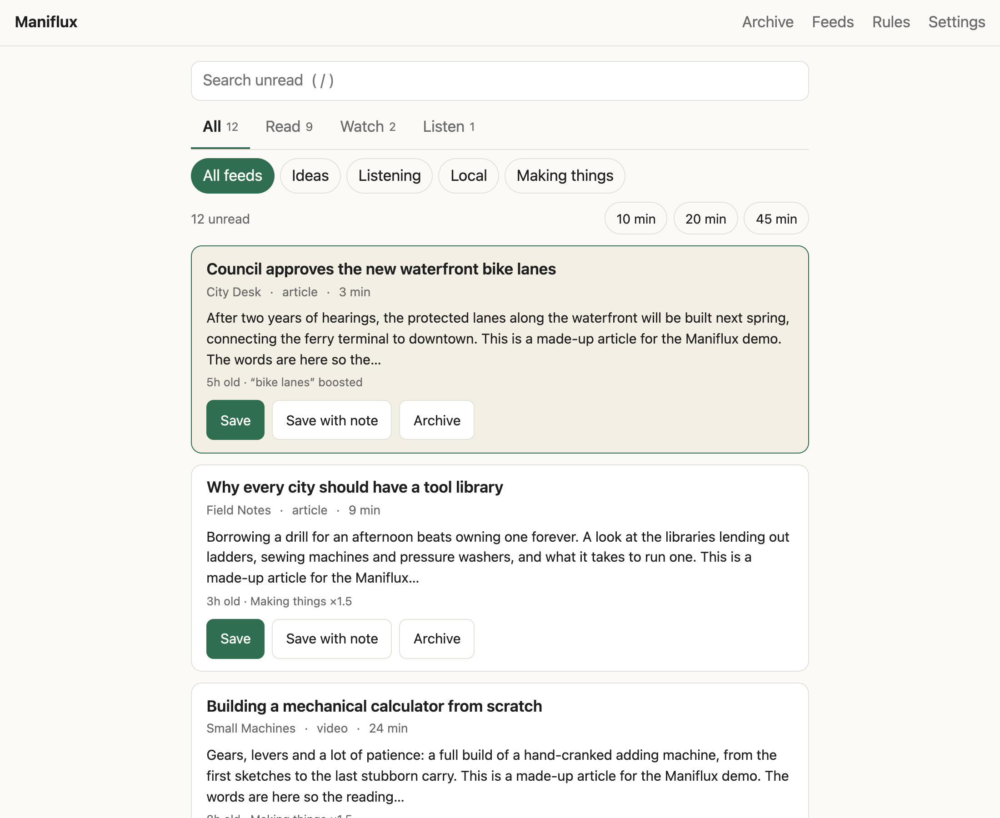
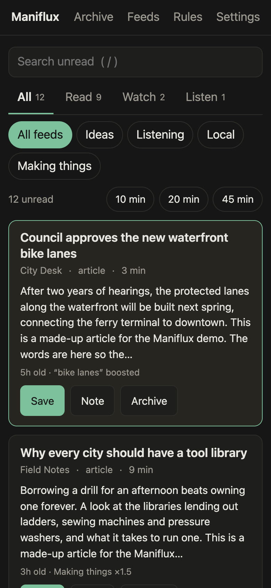
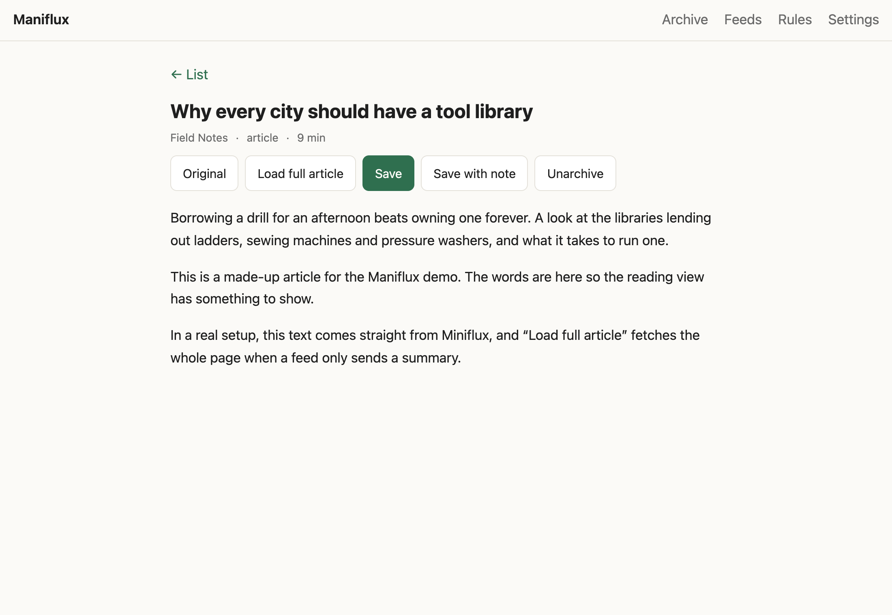
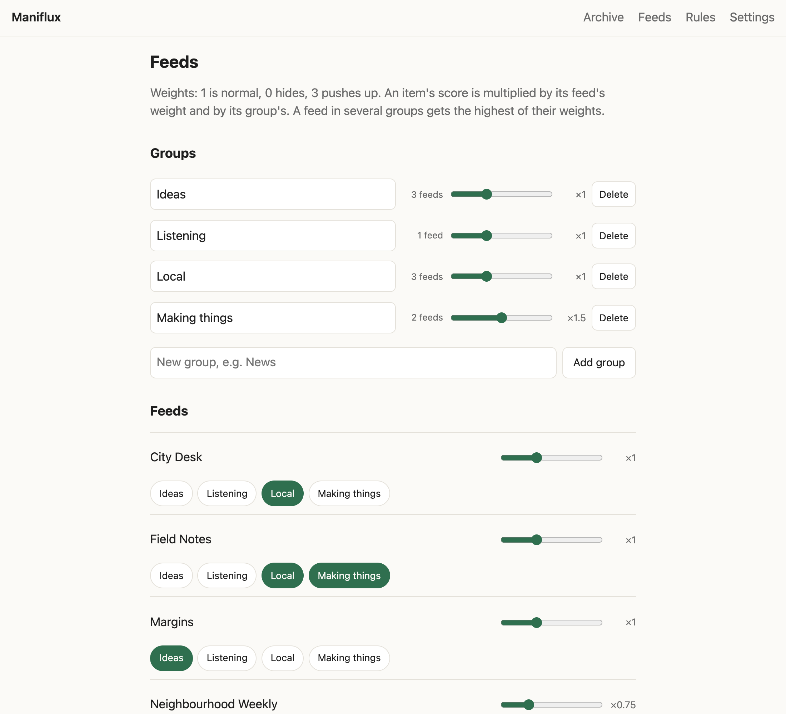
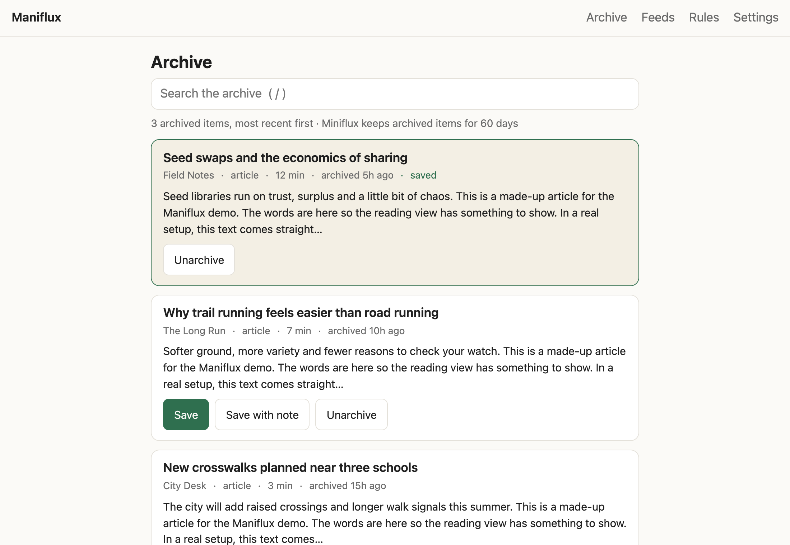

# Maniflux

A small reading app that sits beside [Miniflux](https://miniflux.app). It ranks what's new in your feeds, lets you skim and steer it, and saves anything worth keeping to [Obsidian](https://obsidian.md) as a finished note.

Miniflux keeps fetching your feeds and holds the entries. Maniflux reads them live through Miniflux's API and stores only its own things (weights, groups, rules, what you saved) in a small SQLite file.

This repo also holds the rest of the setup around it: Miniflux in Docker, scripts for a self-hosted [Kill the Newsletter](https://github.com/leafac/kill-the-newsletter) server that turns email newsletters into feeds, and the Obsidian scripts the notes are made for.



<p>
  
  
</p>

*Screenshots use made-up feeds from `maniflux/demo.py`.*

## What it does

- **Ranked list** of unread items, each with the reason for its place ("5h old · Making things ×1.5"). Tabs for All, Read, Watch and Listen; a chip per group of feeds; search with `/`.
- **Time budget:** pick 10, 20 or 45 minutes and get the best items that fit, using reading time and video length.
- **Reading view** with a button to fetch the full article when a feed only sends a summary. Opening an item archives it; Unarchive puts it back.
- **Save to Obsidian:** writes a note to your vault's `content/` folder with title, link, source, author, dates, length, type and a 2–3 sentence description (written by a model through OpenRouter), plus an optional thought of your own. A link already in the vault is never saved twice.
- **Steering:** a weight per feed and per group, and rules: keywords or types to boost, lower or hide, and daily limits ("at most 10 news items a day"), each with an optional end date.
- **Archive page** with Miniflux's full-text search.
- **Keyboard first, phone friendly:** j/k move, o open, v original, s save, S save with a note, x archive, u undo, 1–4 tabs, / search. Single column with large tap targets on a phone.

| Groups and weights | Archive |
|---|---|
|  |  |

## Run it

You need Docker Desktop, and Obsidian if you want to save notes.

```sh
cp .env.example .env      # set the passwords, then fill in the rest below
docker compose up -d miniflux db
```

1. Open http://127.0.0.1:8080, log in with the admin user from `.env`, and add some feeds.
2. In Miniflux, go to Settings → API Keys, create a key and put it in `.env` as `MINIFLUX_API_KEY`.
3. Set `VAULT_CONTENT_PATH` to your vault's `content/` folder and `OPENROUTER_API_KEY` to an [OpenRouter](https://openrouter.ai) key (used for each saved note's description).
4. Start everything: `docker compose up -d`, then open http://127.0.0.1:8090.

Everything binds to `127.0.0.1`, so it's only reachable from your own machine. To use it on your phone, put it behind something like Tailscale rather than opening ports.

### Try it without any setup

```sh
cd maniflux
python3 -m venv .venv && .venv/bin/pip install -r requirements-dev.txt
.venv/bin/python demo.py          # http://127.0.0.1:8099, made-up data, nothing saved
.venv/bin/python -m pytest        # tests
```

## Adding feeds to Miniflux

- **Substack:** `https://<name>.substack.com/feed` (or `<custom-domain>/feed`).
- **YouTube channel:** paste the channel's page URL; Miniflux finds its feed.
- **Most sites:** paste the site's URL; Miniflux finds the feed if there is one.
- **Newsletters with no feed:** `kill-the-newsletter/new-inbox.sh "Name"`, subscribe with the printed address, and add the printed feed URL. See [kill-the-newsletter/README.md](kill-the-newsletter/README.md) for setting up the server.

Back up Miniflux with:

```sh
docker compose exec -T db pg_dump -U miniflux miniflux > backup-$(date +%F).sql
```

## In this repo

| Folder / file | What it is |
|---|---|
| `maniflux/` | The app: FastAPI, SQLite and server-rendered HTML with htmx, no build step |
| `docker-compose.yml`, `.env.example` | Miniflux, its database and Maniflux |
| `kill-the-newsletter/` | Scripts for a self-hosted newsletters-to-feeds server |
| `obsidian/` | Copies of the Obsidian QuickAdd scripts and dashboard the notes are made for, including Process New Clips, which links each new note in a daily journal |
| `docs/BRIEF.md` | Maniflux's scope, design and decisions |
| `docs/SETUP-NOTES.md` | Notes about your own machines; local only, not in git |
| `CLAUDE.md` | Context for AI coding agents |
